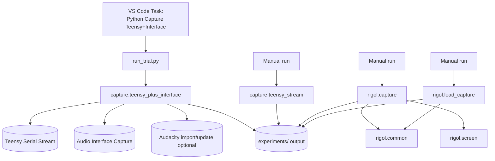

# LTDM Python Scripts
## Warning: I vibe-coded the hell out of this shit big time.
This folder contains two main workflows:

- LTDM Teensy + audio-interface capture, with optional Audacity timeline automation.
- Rigol DS1054Z data capture and review.

## Quick Start

Run an interactive trial:

```bash
cd Code/Python
python3 run_trial.py
```

Run a non-interactive trial:

```bash
cd Code/Python
python3 run_trial.py --experiment TeensyCapture --trial 1 --profile teensy_interface_no_audacity --duration 5
```

Run Teensy-only capture:

```bash
cd Code/Python
python3 -m capture.teensy_stream --port /dev/cu.usbmodem199934501 --trial 1 --duration 5 --save-wav
```

Send test serial control frames to the Teensy:

```bash
cd Code/Python
python3 -m pip install pyserial
python3 send_serial_control.py --port /dev/cu.usbmodem199934501
```

This sends the requested 37-byte frame at 115200 baud every 0.5 seconds.
The two randomized bytes are slider 1 and slider 5, which the firmware uses
as Channel 1 and Channel 2 target RMS values. Press `Ctrl-C` to stop.

Plot the four GainProgression interface captures:

```bash
cd Code/Python
python3 experiments/GainProgression/analysis/plot_trials.py
```

The script writes `experiments/GainProgression/reports/gain_progression_trials.png`.
Use `--channel 2` to plot the second interface channel.

Plot the twelve GainProgression2 captures:

```bash
cd Code/Python
../../.venv/bin/python experiments/GainProgression2/analysis/plot_trials.py
```

The script writes `experiments/GainProgression2/reports/gain_progression2_trials.png`
and `experiments/GainProgression2/reports/gain_progression2_decay_times.png`.

Plot the fourteen GainProgression3 captures:

```bash
../../.venv/bin/python experiments/GainProgression3/analysis/plot_trials.py
../../.venv/bin/python experiments/GainProgression3/analysis/plot_decay_envelope_overlay.py
../../.venv/bin/python experiments/GainProgression3/analysis/plot_spectral_centroid_overlay.py
../../.venv/bin/python experiments/GainProgression3/analysis/plot_decay_rate_vs_gain.py
../../.venv/bin/python experiments/GainProgression3/analysis/plot_decay_rate_vs_gain_with_noise_comp.py --show-confidence
../../.venv/bin/python experiments/GainProgression3/analysis/plot_q_factor_vs_gain.py
../../.venv/bin/python experiments/GainProgression3/analysis/plot_relative_harmonic_energy_vs_gain.py
```

The GP3 scripts discover all numbered trial folders and write their figures to
`experiments/GainProgression3/reports/`.

The noise-compensated decay-rate plot uses the trial-1 calibration report to
stop fits at the visibility threshold. It leaves insufficient fits out of the
numeric series and marks them as either `sustain / no measurable decay` or
`decay estimate limited by noise`; `--show-confidence` adds the usable
post-attack range or status at each gain.

Calibrate the GP3 noise floor from the 45-second no-pluck trial:

```bash
../../.venv/bin/python experiments/GainProgression3/analysis/calibrate_noise_floor.py
```

This writes `gain_progression3_noise_floor.json`, using the 95th percentile of
100 ms noise-window RMS values as the reference floor. The decay-envelope
overlay displays that floor plus a 6 dB visibility margin as dotted threshold
lines, converted into each trial's peak-relative dB scale.

Each trial column reports 1/e amplitude time constants fitted from the
post-attack log envelope. The script finds the envelope peak, skips the first 50
ms of attack, fits a line through the -3 to -15 dB decay region, then converts
that slope to a 1/e time constant. Values are listed for the broadband signal and
for harmonics 1f-6f, each isolated with a zero-phase Butterworth band-pass
centred on `k x string_fundamental_hz` (from the experiment profile). Bands
without enough measurable decay are reported as `sustain`. The decay-times figure
plots the same values against trial number for all three capture blocks.

This script requires `scipy` in addition to `numpy`, `matplotlib`, and `soundfile`.

Plot the GainProgression4 captures (54 trials: 3 repeats x 18 gains 0.00-0.80,
90 s each - about 8x GP3's data volume):

```bash
cd Code/Python/experiments/GainProgression4/analysis
../../../../.venv/bin/python build_audio_cache.py
../../../../.venv/bin/python calibrate_noise_floor.py
../../../../.venv/bin/python plot_trials.py
../../../../.venv/bin/python plot_decay_envelope_overlay.py
../../../../.venv/bin/python plot_spectral_centroid_overlay.py
../../../../.venv/bin/python plot_decay_rate_vs_gain.py
../../../../.venv/bin/python plot_decay_rate_vs_gain_with_noise_comp.py --show-confidence
../../../../.venv/bin/python plot_q_factor_vs_gain.py
../../../../.venv/bin/python plot_relative_harmonic_energy_vs_gain.py
```

GP4 differs from GP3 in two ways that changed how it's processed:

- **3 repeat trials per gain** (GP3 had 1). The gain-axis plots (decay rate,
  decay rate with noise comp, Q factor, relative harmonic energy) now plot the
  **median** of each gain's 3 repeats with error bars spanning **min-to-max**.
  `plot_trials.py` shows one column per gain (not per trial): the repeat whose
  broadband decay time is closest to the group's median is used for that
  gain's waveform/spectrum/spectrogram column.
- **3 no-pluck noise-floor trials** (GP3 had 1). `calibrate_noise_floor.py` and
  `plot_trials.py` pool all 3 trials' noise windows together for a steadier
  95th-percentile estimate (`common.pooled_noise_audio`).

Performance: the two interface-capture channels (Piezo, LTDM Send) are recorded
at 192 kHz, far more bandwidth than any of these plots use (harmonics top out
around 6 x 182 Hz; spectral centroid is capped at 10 kHz). `common.py`
transparently decimates them by an exact factor of 4 to 48 kHz (Nyquist 24 kHz)
and caches the result under `processed/audio_cache/` the first time each
trial/channel is loaded - run `build_audio_cache.py` once up front to populate
that cache in parallel across all trials before running the plotting scripts
(each of which then reads ~1/4 the data). The Teensy stream is already natively
20 kHz and is left untouched. Per-trial analysis (decay/Q/harmonic-energy
collection, and the two overlay plots) is also parallelized across CPU cores
via `common.parallel_map`; `plot_trials.py` itself stays single-process since
it builds one shared matplotlib figure incrementally.

Pitch drift: `string_fundamental_hz` in the experiment profile is only the
string's unactuated (at-rest) response. Resistive (I^2R) heating of the string
and gain-dependent tension changes both detune it *during* a trial, so any
harmonic-band analysis that assumes a fixed fundamental is only approximate at
higher gain / longer capture times. `plot_fundamental_drift_overlay.py` measures
the string's actual instantaneous fundamental directly from the audio (band-pass
around the nominal fundamental, then track the smoothed derivative of the
analytic-signal phase - `common.fundamental_frequency_over_time`) and plots the
drift in cents relative to the profile value, aligned to each trial's peak like
the decay-envelope/spectral-centroid overlays. Run it the same way:

```bash
../../../../.venv/bin/python plot_fundamental_drift_overlay.py
```

Plot how each harmonic drifts relative to a strictly integer multiple of the
fundamental (2nd harmonic exactly 2x, 3rd exactly 3x, etc., or not):

```bash
../../../../.venv/bin/python plot_harmonic_drift_grid.py
```

`plot_harmonic_drift_grid.py` is laid out differently from the other GP4 plots:
one column per gain (17), one row per capture block, with that gain's 3 repeat
trials overlaid per harmonic colour and a dotted reference line at each
harmonic's perfect-integer-multiple frequency, so a harmonic bowing away from
its dotted line is visible directly. Uses `common.harmonic_frequency_over_time`
(same band-pass + phase-derivative tracker as the fundamental overlay, just
centred on `harmonic_number * string_fundamental_hz`).

## Folder Map

- `capture/`: Teensy and interface capture implementations.
- `rigol/`: Rigol capture, scope screen, and shared Rigol plotting helpers.
- `core/`: Shared path, profile, trial-index, and metadata normalisation helpers.
- `analysis/`: Post-capture plotting/inspection tools.
- `docs/`: Python-side technical schema/reference docs.
- `run_trial.py` remains the top-level interactive launcher.

## Metadata Schema

Schema design is fixed in:

- `docs/trial_metadata_schema.md`

This schema is the canonical contract for trial metadata before true acquisition begins.
It defines:

- Required versus optional fields.
- Authority precedence (firmware > measured properties > Python defaults).
- Trial failure semantics.
- Relative-path policy.
- Audacity lifecycle event recording.
- Assignment map policy (including explicit `N/A` for unassigned controls).
- Required TDM timing metadata using meaningful labels (for example sample period, main sense pulse end, alt sense pulse start/end, actuation pulse start) with time and duty-cycle values.

Telemetry integration reads firmware `@TLM1` arm snapshots before capture marker bytes and stores the payload in trial metadata.

Ingestion/persistence writes canonical schema metadata to:

- `trials/trial_####/trial_metadata.json`

This is the single per-trial metadata file; capture scripts no longer write separate operational metadata
files or a `trial_manifest.json` — canonical firmware authority, TDM timing, controls, stream status, and
relative-path file references all live in `trial_metadata.json`. When a trial is captured across multiple
script invocations (for example Teensy+interface followed by a Rigol scope capture), each script loads the
existing `trial_metadata.json` for that trial and merges in its own `streams`/`files` entries rather than
overwriting the file.

Experiment-level metadata that's normally constant across an experiment's trials (`experiment_description`,
string/magnet setup, channel labels) lives in `orchestration/experiment_profile.json`. `trial_metadata.json`
stores a relative pointer to it (`experiment_profile_path`) plus an `experiment_profile_snapshot` — this
trial's actual value for every profile field except `experiment_description`. If a field's value differs
from the previous trial's recorded value, `experiment_profile.json` is automatically rewritten to mark that
field `"VARIABLE"`; from then on every trial is prompted for that field's real value (defaulting to the
previous trial's value), since `experiment_profile.json` no longer holds a single canonical value for it.

Right after the trial number is entered, `run_trial.py` (and `rigol/capture.py` when run standalone) opens
a questionary menu for changing any user-reported parameter (string material, magnet position, etc.).
Choose `done` to keep every current value; edits are saved to `experiment_profile.json` immediately, so the
change-detection above picks them up as this trial's value.

Each trial prompts for `trial_description` (whichever capture script starts the trial first; pre-filled
from that trial's own previous value when overwriting/rerunning a trial), which is stored directly on
`trial_metadata.json`. The operator is prompted once when the experiment profile is created and stored
in `experiment_profile.json`. After every trial, `orchestration/trials_diff.json` is
rebuilt from scratch by recursively diffing every trial's `trial_metadata.json` in the experiment — nested
values are flattened into columns and it only keeps columns whose value actually differs across trials
(plus `trial_number`). Generated file lists, capture timestamps, monotonic timing, Audacity lifecycle
event timestamps, interface alignment measurements, interface channel peak/RMS measurements, and
derived host timing measurements are omitted. Control changes come from `controls.interpreted_state`;
numeric knob, slider, or pedal values are truncated to two decimal places and only count as changed when
the readings differ by more than `0.01`. Button and mode values are compared exactly, so the index
highlights meaningful changes without duplicating every trial's metadata file.

Audacity lifecycle automation records concise `lifecycle_events` with UTC timestamps (launch/open-or-create/import/save/close/error) and persists Audacity status directly into `trial_metadata.json`.
For each experiment, automation uses `audacity/<experiment_name>.aup3`: it opens this project when needed, or creates it on first save without issuing an explicit Audacity New command.
Follow-up trials default to append mode and skip explicit project reopening to avoid "already open in another window" errors; rebuild mode is only forced when track count is successfully queried and is below the required base tracks.
If Audacity is not running, automation fails fast with a recorded lifecycle error rather than hanging on script-pipe open.
To reduce post-import/save instability, additional padding is available with `--audacity-pre-save-delay` and `--audacity-post-save-delay`.
When using `run_trial.py`, these delay flags are forwarded automatically to `capture.teensy_plus_interface`.

Repository hygiene and workflow stability includes two safeguards:

- `run_trial.py` resolves script/output paths from its own file location, so it behaves consistently regardless of current working directory.
- `.gitignore` excludes generated artefacts (`.DS_Store`, `__pycache__`, `.pyc`, trial outputs, and local Audacity project sidecars).

## Folder Highlights

- `capture/teensy_plus_interface.py`: primary capture pipeline (Teensy + interface + Audacity import).
- `run_trial.py`: interactive trial runner using named capture profiles.
- `capture/teensy_stream.py`: Teensy-only binary/WAV capture.
- `rigol/capture.py`: full 4-channel DS1054Z RAW capture to HDF5 + PNG + metadata.
- `rigol/load_capture.py`: browse and plot saved Rigol captures.
- `core/experiment_profile.py`: shared experiment-level metadata loader/prompt/save helper.
- `core/trial_index.py`: per-trial `trial_description` prompt and `orchestration/trials_diff.json` diff-based rebuild helper.
- `rigol/screen.py`: capture scope screen PNG or convert saved raw screen bytes.
- `analysis/plot_teensy_stream.py`: quick matplotlib plot of Teensy `.bin` streams.
- `rigol/common.py`: shared Rigol constants/helpers/plot logic.

## Workflow Diagram



## Requirements

Use Python 3.10+ recommended.

Install core dependencies:

```bash
python3 -m pip install pyserial numpy sounddevice soundfile matplotlib h5py ds1054z python-vxi11 pillow questionary
```

Notes:
- On macOS, `sounddevice` requires microphone permissions for terminal/VS Code.
- Audacity automation requires mod-script-pipe enabled and Audacity running.

### macOS Apple Silicon note (important)

If you see an error like "incompatible architecture (have 'x86_64', need 'arm64')" when importing `matplotlib`, you are launching the script with the wrong Python interpreter.

For this repo, use the project virtual environment interpreter directly:

```bash
cd Code/Python
../../.venv/bin/python -m rigol.capture
```

If needed, reinstall the plotting stack into that same interpreter:

```bash
../../.venv/bin/python -m pip install --upgrade --force-reinstall matplotlib numpy
```

## Recommended Daily Workflow (LTDM Capture)

### Option A: VS Code task (recommended)

Run task:

- `Python: Capture Teensy+Interface (prompt trial/duration)`

This task runs `run_trial.py`, which:

- Prompts experiment name (default `TeensyCapture`) when not passed by flag.
- Prompts for one profile: `interface_audacity`, `interface_no_audacity`, `teensy_interface_audacity`, `teensy_interface_no_audacity`, `rigol_only`, `full_stack_audacity`, or `full_stack_no_audacity`.
- Suggests next trial number from `experiments/TeensyCapture/orchestration/audacity_timeline_state.json` (with folder fallback).
- Lets you override trial (including rerun of an existing trial).
- Prompts for trial duration immediately after trial number for capture profiles; trial 2 and later default to the reference trial's previous `duration_seconds` from `trial_metadata.json`.
- Runs a preflight connection check for the devices required by that profile before experiment metadata is entered or edited: Teensy serial port, audio-interface input, and/or Rigol scope.
- Accepts `--duration` as an override for a specific run.
- For every trial after the experiment profile exists, shows an arrow-navigable field list (current values shown); choose `done` to make no changes, or edit fields before capture.
- Prompts once for experiment metadata if `orchestration/experiment_profile.json` does not yet exist.
- Launches `capture.teensy_plus_interface` with project defaults.

You can run only the connection check without entering/editing metadata or creating trial folders:

```bash
cd Code/Python
python3 run_trial.py --experiment TeensyCapture --trial 1 --profile teensy_interface_no_audacity --preflight-only
```

Use `--skip-preflight` only when you intentionally need to bypass these checks.

### Capture Profiles

- `interface_audacity`: Interface recording only, with Audacity import.
- `interface_no_audacity`: Interface recording only, without Audacity import.
- `rigol_only`: Rigol capture only for the selected experiment/trial.
- `teensy_interface_audacity`: Teensy + interface recording, with Audacity import.
- `teensy_interface_no_audacity`: Teensy + interface recording, without Audacity import.
- `full_stack_audacity`: Teensy + interface + Audacity + Rigol.
- `full_stack_no_audacity`: Teensy + interface + Rigol, without Audacity import.

### Option B: direct command

```bash
cd Code/Python
python3 -m capture.teensy_plus_interface \
  --port /dev/cu.usbmodem199934501 \
  --trial 7 \
  --duration 3 \
  --iface-device 6 \
  --iface-sample-rate 192000 \
  --iface-channels 2 \
  --iface-start-mode arm-gated \
  --iface-pre-roll 0.05 \
  --iface-post-roll 0.05 \
  --iface-trim-to-teensy \
  --iface-auto-align \
  --audacity-import \
  --audacity-command-spacing 0.25 \
  --audacity-reset-passes 3 \
  --audacity-pre-import-delay 0.10 \
  --audacity-post-import-delay 0.10
```

Audio + Rigol in one run:

```bash
cd Code/Python
python3 -m capture.teensy_plus_interface \
  --port /dev/cu.usbmodem199934501 \
  --trial 7 \
  --duration 3 \
  --iface-device 6 \
  --iface-sample-rate 192000 \
  --iface-channels 2 \
  --iface-start-mode arm-gated \
  --iface-pre-roll 0.05 \
  --iface-post-roll 0.05 \
  --iface-trim-to-teensy \
  --iface-auto-align \
  --audacity-import \
  --post-rigol
```

## Script Reference

1. `run_trial.py`
Purpose: interactive daily launcher (experiment/trial/profile prompts, duration defaults, metadata edits for follow-up trials).
Run:

```bash
cd Code/Python
python3 run_trial.py
```

2. `capture/teensy_plus_interface.py`
Purpose: main synchronized capture path (Teensy + interface + optional Audacity + optional post-Rigol).
Run:

```bash
cd Code/Python
python3 -m capture.teensy_plus_interface --help
```

Key flags: `--iface-list-devices`, `--iface-start-mode`, `--iface-auto-align`, `--iface-trim-to-teensy`, `--audacity-import`, `--audacity-reset-timeline`, `--post-rigol`, `--debug`.

3. `capture/teensy_stream.py`
Purpose: Teensy-only capture, with optional WAV output.
Run:

```bash
cd Code/Python
python3 -m capture.teensy_stream --port /dev/cu.usbmodem199934501 --trial 1 --duration 5 --save-wav
```

4. `analysis/plot_teensy_stream.py`
Purpose: quick viewer for Teensy `.bin` streams.
Run:

```bash
cd Code/Python
python3 -m analysis.plot_teensy_stream experiments/TeensyCapture/trials/trial_0001/macro_audio/teensy_stream.bin --duration 1.0 --channel 1
```

5. `rigol/capture.py`
Purpose: DS1054Z RAW capture (HDF5 + PNG + scope metadata) attached to experiment/trial.
Run:

```bash
cd Code/Python
python3 -m rigol.capture
python3 -m rigol.capture --experiment MyFirstExperiment --trial 1
```

6. `rigol/load_capture.py`
Purpose: interactive loader/plotter for previous Rigol captures.
Run:

```bash
cd Code/Python
python3 -m rigol.load_capture
```

7. `rigol/screen.py`
Purpose: scope screen capture and `.bin` to `.png` conversion.
Run:

```bash
cd Code/Python
python3 -m rigol.screen --ip 169.254.123.183 --out rigol_screen.png
python3 -m rigol.screen --bin 20260811_rigol_screen.bin
```

8. `rigol/common.py` (internal shared module)
Purpose: `SCOPE_IP`, channel labels/colours, conversion helpers, and scope-style plotting utilities used by Rigol tools.

Primary per-trial outputs from the main capture path:
- `trials/trial_####/macro_audio/teensy_stream.bin`
- `trials/trial_####/macro_audio/teensy_stream_Ch1.wav`
- `trials/trial_####/macro_audio/teensy_stream_ch2.wav`
- `trials/trial_####/macro_audio/interface_capture_ch1.wav`
- `trials/trial_####/macro_audio/interface_capture_ch2.wav`
- `trials/trial_####/trial_metadata.json`

## Data Layout

Typical output tree:

```text
Code/Python/experiments/
  TeensyCapture/
    orchestration/
      experiment_profile.json
      trials_diff.json
      audacity_timeline_state.json
    trials/
      trial_0001/
        trial_metadata.json
        macro_audio/
          teensy_stream.bin
          teensy_stream_Ch1.wav
          teensy_stream_ch2.wav
          interface_capture_ch1.wav
          interface_capture_ch2.wav
        micro_scope/
          capture_001/
            rigol_capture.h5
            rigol_capture.png
            rigol_screen.png
            scope_capture_meta.json
  <OtherExperimentName>/
    orchestration/
      experiment_profile.json
      trials_diff.json
    trials/
      ...
```

## Troubleshooting

Audacity import does not work:
- Open Audacity first, enable mod-script-pipe, then verify both pipes exist: `/tmp/audacity_script_pipe.to.<uid>` and `/tmp/audacity_script_pipe.from.<uid>`.

No interface input:
- List devices with `python3 -m capture.teensy_plus_interface --iface-list-devices`, then set `--iface-device` and check macOS microphone permissions.
- `run_trial.py` checks the configured interface device before metadata prompts. If it fails, connect the interface or update `DEFAULT_IFACE_DEVICE` in `run_trial.py` to the device index/name shown by `--iface-list-devices`.

Rigol connection fails:
- Confirm `SCOPE_IP` in `rigol/common.py`, verify LAN link, and confirm the scope is reachable on VXI-11.

## Quick Sanity Checks

Compile scripts:

```bash
cd Code/Python
python3 -m py_compile run_trial.py capture/teensy_plus_interface.py capture/teensy_stream.py rigol/capture.py rigol/load_capture.py rigol/common.py rigol/screen.py core/experiment_profile.py core/path_layout.py core/trial_metadata.py core/trial_index.py analysis/plot_teensy_stream.py
```

Run one prompted trial:

```bash
cd Code/Python
python3 run_trial.py
```
